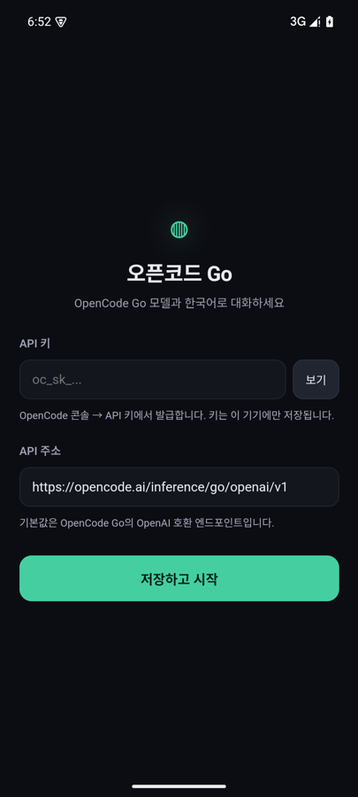
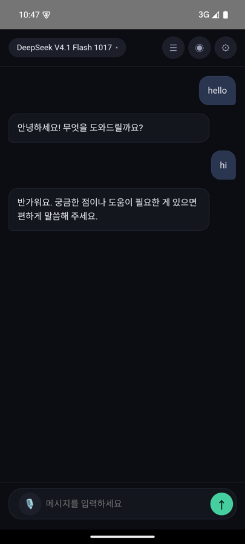
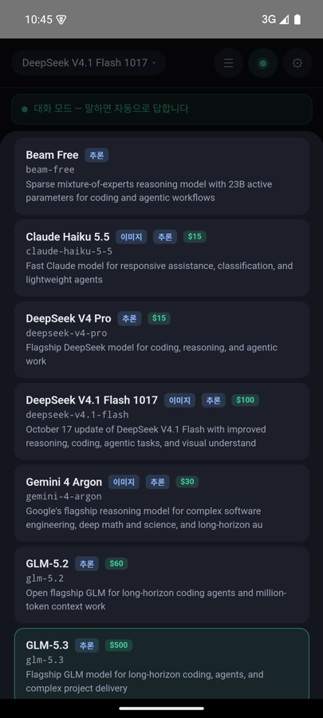

# 오픈코드 Go (OpenCode Go Mobile)

**OpenCode Go 구독 모델을 안드로이드에서 한국어 음성 대화로 쓰는 앱.**

PC나 서버 없이 폰에서 바로 OpenCode Go API에 붙습니다. 키는 기기에만 저장되고,
말로 물으면 말로 답합니다.

<p align="center">
  
  
  
</p>

## 기능

- **한국어 UI** — 설정·대화·모델 선택 전부 한국어
- **음성 대화 모드** — 말하면 자동 전송 → 응답을 읽어주고 → 다시 듣기 (연속 대화)
- **음성 입력** — 안드로이드 `SpeechRecognizer`(ko-KR), 말하는 중 부분 인식 표시
- **음성 출력** — `TextToSpeech`(ko-KR), 읽기 속도 조절
- **모델 선택** — OpenCode Go 라이브 목록(32종), 검색·선택. 이미지/추론 배지와 모델별 월 사용량 표시
- **웹 검색 (무료 · 키 불필요)** — 모델이 필요하면 스스로 검색하고 페이지를 읽습니다.
  DuckDuckGo HTML + 위키백과 폴백, 결과는 답변 아래 출처 링크로 표시
- **토큰 스트리밍** — 응답이 실시간으로 흐름
- **대화 저장** — 최근 30개 대화를 기기에 저장, 목록에서 전환·삭제
- **키 보호** — 화면에서 입력, 기기 저장소에만 보관 (앱에 하드코딩 없음)

## 설치

[Releases](../../releases)에서 `ocgo-mobile-1.0.apk`를 받아 설치합니다.
(안드로이드 6.0 이상, "출처를 알 수 없는 앱" 허용 필요)

```bash
adb install -r ocgo-mobile-1.0.apk
```

첫 실행 후 **OpenCode 콘솔 → API 키**에서 발급한 `oc_sk_...`를 붙여넣으면 끝입니다.

## 빌드

요구사항: JDK 17+, Android SDK(platforms;android-35, build-tools;35.0.0), Node 20+

```bash
npm install
npx cap sync android
cd android && ./gradlew assembleDebug     # 디버그 APK
cd android && ./gradlew assembleRelease   # 서명된 릴리스
```

서명은 `android/keystore.properties`(storeFile/storePassword/keyAlias/keyPassword)를 읽습니다.
이 파일과 키스토어는 `.gitignore`에 있어 저장소에 올라가지 않습니다.
편의 스크립트: `scripts/build.sh`.

## 구조

```
www/                        웹 UI (HTML/CSS/JS, 프레임워크 없음)
  index.html  style.css  app.js
android/app/src/main/java/dev/zzanggu/ocgo/
  MainActivity.java         플러그인 등록
  OcStreamPlugin.java       OkHttp SSE → JS 델타 이벤트 (WebView CORS 우회)
  OcSpeechPlugin.java       SpeechRecognizer + TextToSpeech
scripts/
  build.sh                  동기화 + 아이콘 + APK
  make_icons.py             아이콘 생성 (외부 라이브러리 없이 PNG 인코딩)
  mock_sse_server.py        스트리밍 검증용 mock 서버
```

OpenCode Go의 OpenAI 호환 엔드포인트를 씁니다.

```
GET  {base}/models
POST {base}/chat/completions   (stream: true)
base 기본값: https://opencode.ai/inference/go/openai/v1
```

## 웹 검색 동작 방식

```
사용자 질문 → 모델이 web_search 호출 → 앱이 DuckDuckGo HTML 결과 5건 수집
→ 필요하면 open_url로 상위 페이지 본문 읽기 → 근거와 함께 답변 + 출처 표시
```

- 검색은 **DuckDuckGo HTML 엔드포인트**(키 불필요)를 쓰고, 실패하면 **위키백과 API**로 폴백합니다.
- 유료 검색 API(Brave/Tavily 등)는 쓰지 않습니다. API 키를 넣을 필요가 없습니다.
- 설정에서 "웹 검색 사용"을 끌 수 있습니다.
- 검색·페이지 결과는 10분간 캐시해 같은 질문 반복 시 요청을 줄입니다.
- 답변 아래 출처는 번호와 링크로 표시되고(탭하면 스니펫이 펼쳐짐), 본문 `[1]` 인용은 링크로 바뀝니다.
- 답변에 인용이 없으면 숫자가 포함된 문장에 출처 번호를 자동으로 붙입니다.
- 응답이 반복 루프에 빠지면 감지해 한 번 재시도하고, 재발하면 **안정적인 모델(glm-5.3 등)로 자동 전환**합니다.
- 그래도 반복되면 잘라내고 안내합니다(반복 횟수 표시).
- 대화 모드에서는 긴 답변을 핵심 2~3문장으로 줄여 읽어줍니다.
- 검색이 모두 실패하면 "아는 범위에서 답합니다"를 안내합니다.
- 검색 결과가 부족하면 모델이 두 번째 검색을 시도합니다(최대 2라운드).

## 개발 메모

- **Android 15 엣지투엣지**: targetSdk 35에서는 `windowOptOutEdgeToEdgeEnforcement=true`가 없으면
  툴바가 상태바 아래로 말려 모델 선택 버튼이 가려집니다.
- **WebView CORS**: `CapacitorHttp`는 스트리밍을 지원하지 않아 OkHttp로 SSE를 직접 읽습니다.
- **Google Maven 장애**: `Remote host terminated the handshake`가 뜨면 `android/build.gradle`의
  예비 미러(알리윤)가 도움이 됩니다.

## 주의

- **비공식 앱입니다.** OpenCode와 무관한 개인 프로젝트입니다.
- OpenCode Go **구독이 필요**합니다. 키 없이는 동작하지 않습니다.
- 음성 인식은 기기의 인식 엔진(구글/삼성)에 의존하며, 오프라인이면 동작하지 않습니다.
- 기기를 넘기거나 잃어버렸다면 OpenCode 콘솔에서 키를 폐기하세요.

## 라이선스

MIT
